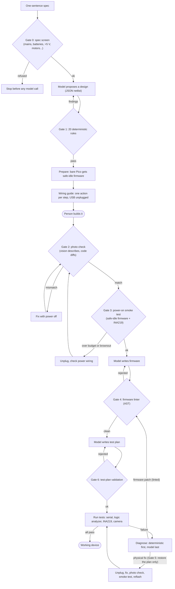

# Hands

**An AI hardware engineer that uses a non-expert human as its hands.**

[](https://github.com/DevPatel3547/hands/actions/workflows/ci.yml)


You describe a gadget in one sentence. A language model designs it, and Hands walks a person
who has never touched a breadboard through building it, one jumper at a time. The model never
touches the hardware and never has the final say on safety. It proposes; deterministic code
checks; the person acts; instruments verify.

1. **Design** a circuit from **only the parts you own** (a ~$75 breadboard kit).
2. **Check** it against **20 deterministic electrical rules** built on datasheet numbers.
   A failing design is sent back to the model with the findings. It never reaches the person.
3. **Guide** the build one physical action at a time, with exact hole coordinates
   (`Connect b10 to e25`), in the terminal or on a phone-friendly web page.
4. **Verify the wiring from a photo** *before* USB power is ever applied.
5. **Power on safely:** safe-idle firmware first, then a current measurement on the 3V3 rail.
6. **Write, lint and flash** MicroPython firmware for a Raspberry Pi Pico W.
7. **Test** the gadget with instruments (USB serial, logic analyzer, INA219 current sensor,
   camera) and, when something fails, **debug it** with the person, one step at a time.

```bash
pip install -e . && hands demo steelers --sim    # no hardware, no API key, no money
```

---

## Status

> | | |
> |---|---|
> | **Works today** | The full loop runs end to end on a **simulated bench**: circuit solver, as-built breadboard, MicroPython runtime and a simulated person who makes realistic mistakes. **178 tests pass** (89% branch coverage). All **7 injectable wiring mistakes** are caught and fixed in tests, before or after power-on. |
> | **Built, not yet proven** | The real-hardware path (Pico port discovery, flashing via `mpremote`, on-board current monitor, logic analyzer via `sigrok-cli`, camera, `hands doctor`, `hands bringup`, `hands run --real`) is implemented and unit-tested against fakes. **It has not yet been run on a physical board.** |
> | **Not done yet** | **No real model has been run end to end.** Every demo uses the scripted model (canned replies). The Claude and Ollama adapters are implemented and tested against a fake server only. **No user-study participants yet.** The protocol is written; no sessions have been run. |

Everything below is written to match that status. Where a number comes from the simulator, it
says so.

---

## Why this matters

In [Project Fetch](https://www.anthropic.com/research/project-fetch-robot-dog), Anthropic split
eight researchers without robotics experience into two teams and had them program a robot dog
to fetch a ball. The team with Claude finished the tasks both teams completed in about half the
time. Project Fetch measured **controlling existing hardware**. The write-up names the next
step directly: *"it is one thing to control existing hardware, and another to design, build,
and improve new hardware."*

Hands is a small, cheap, measurable probe of that second question:

- **Can a model design new hardware that a non-expert can actually build?** The model has no
  arms. A person does the physical work, so the agent has to plan, give instructions a
  beginner can follow, and recover from that person's mistakes.
- **Can it do that safely?** Model output is treated as untrusted input. Every design,
  instruction, firmware image and test plan passes through deterministic gates before it can
  affect the physical world.
- **Can it close the loop?** The agent does not trust the person or itself. It checks a photo
  before power, measures current at power-on, and runs instrumented tests after. It logs every
  step, so the claims can be measured instead of asserted.

The bench is also exposed as an **MCP server** (`hands mcp`), so any MCP client, including
Claude Code, can drive the same lint-gated tools: flash firmware, read serial, capture a logic
trace, read current, take a photo, cut power.

---

## The loop



**Diagnosis order.** When a test fails, code tries the cheap, certain checks first:

1. Board unresponsive or over current: treat it as a power fault. Unplug, check the power wiring.
2. I2C device or DHT22 not answering: ask the person to check that part's wiring.
3. LED, buzzer or servo not doing anything: flash **known-good diagnostic firmware** that
   toggles the pin, then **walk the signal path** hole by hole with the logic analyzer until
   the signal disappears. That pinpoints the bad jumper.
4. Only when all of that comes up empty does the model get the evidence and propose either a
   firmware patch (linted like any other firmware) or a physical fix (allowed only if it
   *restores the approved plan*).

Every physical fix follows the same sequence: unplug, change, photo check, smoke test,
reflash.

<details><summary>Detailed architecture (ASCII)</summary>

```
 spec ─► safety screen ─► LLM design JSON ─► rules.require_safe (20 rules) ──✗──► LLM revises with findings
          (mains? LiPo?)                              │✓  HARD GATE 1
                                                      ▼
         prepare: bare Pico gets safe-idle firmware (an old main.py can't drive the new circuit)
                                                      ▼
         layout.place ─► wiring.build_guide   (both re-run gate 1)  ─► one action per step
                                                      ▼
         person builds it  (terminal / web UI on a phone / SimHuman with injected mistakes)
                                                      ▼
         camera ─► vision describes (sanitised JSON) ─► wiring.compare decides ──✗──► fix (USB unplugged)
                                                      │✓  HARD GATE 2: no power without a passing photo check
                                                      ▼
         plug in ─► safe-idle firmware ─► INA219 smoke test ──✗──► UNPLUG ─► power-wiring check ─► photo check
                                                      │✓
                                                      ▼
         LLM firmware ─► fwlint (pins ⊆ checked pin_map, no button outputs, no raw registers) ─► flash
                                                      ▼
         LLM test plan ─► validated ─► run with serial / logic analyzer / INA219 / camera
                                                      │✗
                                                      ▼
         diagnose: power fault → I2C/sensor wiring → known-good firmware + logic-probe walk
                   → LLM (firmware patch: linted | physical fix: may only RESTORE the plan)
         every physical fix: unplug → change → photo check → smoke test → reflash
```

| Module | Role | Calls a model? |
|--------|------|----------------|
| `safety.py` | Hard ceilings, spec screen, allow-listed part kinds | no |
| `rules.py` | The 20 rules and the `require_safe` gate | **no** |
| `fwlint.py` | Firmware linter (Python AST) | no |
| `circuit.py`, `inventory.py`, `data/starter_kit.yaml` | Netlist model, strict parsing, part facts | no |
| `layout.py`, `wiring.py` | Breadboard placer, step list, ASCII/SVG diagrams, photo diff | no |
| `agent.py` | The engineer loop and its gates | orchestrates |
| `diagnose.py` | Signal-path walk, known-good diagnostic firmware | no |
| `llm.py`, `prompts.py` | Scripted / Anthropic / OpenAI-compatible (Ollama) adapters | yes |
| `vision.py` | Model vision (describes only), console self-check, sim vision | perception only |
| `bench/` | `RealBench` (mpremote, pyserial, sigrok, OpenCV), `SimBench`, MCP server | no |
| `firmware/` | On-Pico current monitor (`hands_bench.py`) and `main.py` shim | no |
| `doctor.py`, `bringup.py` | Environment check, guided first-time hardware check | no |
| `webui/` | Single-page wiring guide (stdlib server, strict CSP) | no |
| `metrics.py` | JSONL session logs, terminal and markdown study reports | no |
| `sim/` | Nodal circuit solver, as-built board, MicroPython runtime, simulated person | no |

</details>

---

## Safety architecture

The design principle is one sentence: **the model proposes, code decides.** No model output
reaches a wiring step, a power-on or a flash without passing a deterministic check. Full
details, every number and its datasheet source: [`docs/safety.md`](docs/safety.md).

### The hard gates

| # | Gate | Where | Blocks |
|---|------|-------|--------|
| 0 | **Spec screen** | `safety.screen_text` | Specs about mains, batteries, >5 V, >500 mA, motors, relays, heaters or lasers, refused **before any model call**. The same screen runs on model-written text shown to the person. |
| 1 | **Rule check** | `rules.require_safe` | Any design with an `error` finding. Re-run inside `layout.place()`, `wiring.build_guide()` and before every physical stage, with a digest check so a design changed after checking is caught. |
| 2 | **Photo check** | `agent.stage_photo_check`, `wiring.compare` | USB power before the latest wiring matches the plan. Any physical change resets it. The vision model only *describes*; code does the diff. |
| 3 | **Smoke test** | `agent.stage_power_on` | Every power-on starts with safe-idle firmware (all GPIOs high-impedance inputs) and an INA219 reading. Over budget, or a board that stops answering, means unplug immediately. |
| 4 | **Firmware lint** | `fwlint.lint_firmware` | Firmware that could do something the rule check never approved. Runs again inside `_flash()` and in the MCP `flash_firmware` tool. |
| 5 | **Fix validation** | `agent.validate_fix` | Model-suggested physical changes that don't restore the approved plan (allowed: re-seat a planned wire, re-check a placed part, inspect the rails). The instruction is generated by code; a model hint is appended only if it passes the spec screen. |
| 6 | **Test-plan validation** | `agent.validate_test_plan` | Tests that toggle GPIOs outside the design or a button pin, press non-buttons, use bad regexes, or wait or measure too long. |

Plus two invariants in `agent.py`: **every physical change happens with USB unplugged**
(`_human_change` refuses while powered), and **the bare Pico gets safe-idle firmware before
the first wiring step**, because a real Pico keeps its last `main.py` and an old program could
otherwise drive pins into the new circuit.

### The 20 rules

`hands rules` prints them with the effective limits. All are plain Python over the netlist.

| | | | |
|---|---|---|---|
| `structure` | `inventory` | `pin_conflict` | `power_short` |
| `gpio_short` | `shorted_part` | `unconnected_pin` | `led_resistor` |
| `led_polarity` | `led_current` | `gpio_current` | `transistor` |
| `buzzer_polarity` | `servo_power` | `module_power` | `i2c` |
| `dht` | `overvoltage` | `resistor_power` | `rail_budget` |

A few that matter most:

- **`gpio_current`**: per-pin worst case > 12 mA or total > 50 mA, using minimum LED Vf
  (lower Vf means more current, so the minimum is the safe bound).
- **`overvoltage`**: any path that puts 5 V on a GPIO, through a resistor, LED, buzzer or
  button (up to 4 hops), or through a module's on-board pull-ups when it is powered from 5 V.
- **`structure`**: the design may use only `pico.GPn` pins. Power is wired by the fixture,
  so designs cannot touch VBUS, VSYS, 3V3, RUN or 3V3_EN, and cannot use reserved net names.
- **`rail_budget`**: 3V3 regulator load ≤ 300 mA, total USB draw ≤ 500 mA, warning on servo
  stall current.

**Hard limits only get stricter.** `HARD_LIMITS` in `safety.py` is a ceiling: the YAML can
tighten a limit but never loosen it. Part kinds are an allow-list of 8 (`led`, `resistor`,
`buzzer`, `npn`, `button`, `dht22`, `ssd1306`, `servo`). A new kind is refused until it has rules.

### The firmware linter

Model-written MicroPython is parsed with Python's `ast` before anything is flashed:

- only allow-listed imports; no `eval`, `exec`, `open` or dunder access;
- every `Pin(...)` names a literal or module-constant GPIO from the rule-checked `pin_map`.
  Computed pin numbers are refused, so the linter can always tell which pins are driven;
- a pin wired to a button is never an output (pressing the button would short it to GND);
- I2C, SPI and UART must name their pins (the defaults may be pins the design never checked);
- no raw register access (`machine.mem32`), deep sleep, overclocking or bootloader jumps.

### Power-on gating

USB power is applied only when (1) the design passed the rules, (2) the most recent photo
check since the last physical change passed, and (3) the board is about to boot safe-idle
firmware. The INA219 then measures the 3V3 rail against a budget derived from the rule
checker's own current estimate. A short (`hidden_short` in the simulator) shows up as a
brownout. The agent unplugs, asks for a power-wiring check, and runs the photo check again
before it tries power a second time.

### Bypasses found and fixed

A dedicated hardening pass found **more than 20 ways around these checks**: pin aliasing
through Pico power pins and reserved net names, gates that later code paths skipped, and
firmware-linter gaps such as `from machine import Pin as P` and computed pin numbers. All are
fixed, and each has a regression test. `docs/safety.md` groups them into 14 categories, and the
full list is in [`CHANGELOG.md`](CHANGELOG.md). The story is in
[`docs/BUILD_LOG.md`](docs/BUILD_LOG.md).

---

## Demo gadgets

Three built-in gadgets exercise different parts of the rule set and the debugger. In the
simulator each one runs with realistic mistakes injected by default.

| Gadget | What it does | Parts | What the demo shows |
|--------|--------------|-------|---------------------|
| **`steelers`**: Steelers score light | Desk light with an on/off button. Buzzer and light show when the Pittsburgh Steelers score. | Yellow LED + 220 Ω on GP15, button on GP14, active buzzer driven by a PN2222A from GP16 through 1 kΩ | Design v1 puts the buzzer straight on GP16 (~25 mA) and the `gpio_current` rule **rejects it**. v2 adds the transistor. The photo check catches a **resistor replaced by a jumper** before power. The signal walk finds a **loose jumper** after power. 9/9 tests pass, then a mock game is replayed through the score bridge. |
| **`tempdisplay`**: temperature display | Room temperature and humidity on a small OLED, updated every couple of seconds. | DHT22 module on GP15, SSD1306 OLED on I2C0 (GP4/GP5), both on 3V3 | The photo check catches **swapped SDA/SCL**. A **hidden short** the camera can't see browns out the board at the smoke test; the agent unplugs and has it fixed before retrying. 7/7 tests pass. |
| **`servo`**: servo pointer | A needle on a servo points at a 0-100 value sent from the computer. | SG90 servo, signal on GP16, power on the 5 V (VBUS) rail | Design v1 powers the servo from 3V3 and **two rules reject it**. v2 moves it to 5 V. The photo check catches the **servo on the wrong rail**. A firmware slip (servo PWM at 500 Hz instead of 50 Hz) gets past the deterministic hardware checks, so the **model diagnoses it** and its firmware patch is flashed after the linter approves it. 6/6 tests pass. |

The live Steelers feed (`hands bridge --feed espn`) runs on the computer and sends
`SCORE <points> <total>` over USB serial. It uses ESPN's **unofficial, undocumented** scoreboard
endpoint, polled at most every 15 s. Check that it still works, and check ESPN's terms, before
you rely on it.

---

## 60-second quickstart (simulated bench)

No hardware, no API key, no money. Python 3.11+.

```bash
git clone https://github.com/DevPatel3547/hands.git && cd hands
python -m venv .venv && . .venv/bin/activate      # Windows: .venv\Scripts\activate
pip install -e ".[dev]"

hands demo steelers --sim     # design rejected -> redesign -> build -> 2 mistakes caught -> working
hands demo all --sim          # all three gadgets
hands report                  # summary table of the runs above
hands guide steelers --web    # the wiring guide at http://127.0.0.1:8765 (Ctrl-C to stop)
```

Or with Docker: `docker build -t hands-sim . && docker run --rm hands-sim`.

<details><summary>What <code>hands demo steelers --sim</code> prints (abridged)</summary>

```
-- Design v1 'steelers-desk-light': 4 parts, 5 nets
   Rule check: FAIL (1 error(s))
     [ERROR] gpio_current: GP16 would carry ~25.0 mA (> 12 mA max): bz1 buzzer directly on pin ~25 mA. Use a transistor or a bigger resistor.
-- Design v2 'steelers-desk-light': 6 parts, 8 nets
   Rule check: PASS (no findings)
-- Prepare: plug in the bare Pico (nothing on the breadboard yet), load safe-idle firmware
-- Wiring guide: 27 steps, 17 jumpers
      (sim human mistake: series resistor left out and replaced with a jumper -- jumper i20-f24 instead of r1)
      (sim human mistake: a jumper that looks inserted but isn't making contact -- W15 not pushed in fully)
-- Photo check round 1: 1 problem(s) caught BEFORE power-on
   ! r1 is missing and a jumper (i20-f24) is in its place
-- Power-on #1: plug in USB, flash safe-idle firmware, read 3V3 rail current
   3V3 rail idle current 0.0 mA (budget 58 mA): OK
   [FAIL] touchdown_buzzer: {"probe": "a46", "edges": 0, ...}
-- Debug round 1: diagnosing 'touchdown_buzzer'
     probe   a20 (BUZ_DRV): signal
     probe   a38 (BUZ_DRV): NO SIGNAL
   -> ask human: The signal reaches a20 but not a38. Wire W15 should run d38 -> b20: pull it out and push both ends firmly back ...
      UNPLUG THE USB CABLE NOW. Reason: signal walk found a break
-- Photo check round 1: wiring matches the plan
-- Power-on #1: ... OK
== All 9 tests pass: device WORKING
   design errors caught by rules: 1   errors caught pre-power: 1   post-power: 1
   time to working device (sim estimate): 20.9 min (human actions 20.5 min + bench 24 s)
```
</details>

**Try other mistakes.** `hands faults` lists the 7 injectable mistakes: `reversed_led`,
`missing_resistor`, `wrong_pin`, `loose_wire`, `hidden_short`, `swapped_i2c` and
`servo_wrong_rail`. `--vision-miss` makes the simulated camera miss one, so the instruments have
to catch it after power-on instead:

```bash
hands demo steelers --sim --faults reversed_led,wrong_pin --vision-miss reversed_led
hands check steelers           # run the rules on the flawed v1 design
hands check steelers --final   # ...and on the approved v2
```

---

## Hardware quickstart

> Not yet run on a physical board (see [Status](#status)). Expect a few fixes during the first
> bring-up. Issues with logs are very welcome.

1. **Buy the kit** in [`SHOPPING_LIST.md`](SHOPPING_LIST.md): a Pico WH, breadboard, LEDs,
   resistors, buzzer, buttons, PN2222A, DHT22, SSD1306 OLED, SG90 servo and INA219. About $70-85
   if you use a phone camera, $85-110 with a webcam. The logic analyzer (~$10-13) is optional.
2. **Install the real-bench extras:** `pip install -e ".[real]"`. For the logic analyzer,
   also install `sigrok-cli` (`sudo apt install sigrok-cli` or `brew install sigrok-cli`).
3. **Put MicroPython on the Pico W:** hold BOOTSEL while plugging it in, then drag the
   [Pico W UF2](https://micropython.org/download/RPI_PICO_W/) onto the `RPI-RP2` drive.
4. **`hands doctor --real`** checks Python, pyserial, mpremote, the Pico's port (found
   automatically by USB vendor ID on macOS, Linux and Windows), MicroPython, the INA219,
   sigrok, the camera and any configured model, and prints the exact fix for anything missing.
5. **`hands bringup`** is a guided first-time check, one part at a time: blink the on-board LED
   and confirm you saw it; wire only the Pico and the INA219, one jumper at a time with USB
   unplugged; power on with safe firmware and sanity-check current and voltage; run a
   logic-analyzer self-test on GP15; take a camera snapshot.
6. **Build a gadget:**
   ```bash
   hands run steelers --real                      # free: scripted model, you answer yes/no check questions
   hands run steelers --real --camera prompt      # give phone photos for the photo checks
   hands run steelers --real --model ollama --vision-model ollama:qwen2.5vl:7b   # free local models
   hands run "a night light that turns on when it's dark" --real --model anthropic
   ```
   To follow along on a phone: `hands guide steelers --web --host 0.0.0.0`. The page shows a
   diagram for each step, a progress bar and photo upload, and keeps a large red "do not plug
   in" panel up until every step is done and the photo check has passed. Bound beyond
   localhost, it requires a random access token.

Before wiring, compare the INA219 and OLED pin orders printed on *your* boards with `pins:` in
`hands/data/starter_kit.yaml`. Clones differ, and the wiring guide is generated from that file.

**How current is measured while your program runs.** Hands installs `hands_bench.py` next to
the gadget firmware with a two-line `main.py` shim. The helper samples the INA219 on its own
SoftI2C bus (GP26/GP27) every 20 ms and prints `#INA avg max bus n` lines, which the host strips
from the program's output. So "does the buzzer really draw current?" is measured *while the
buzzer sounds*.

---

## Model providers

| `--model` | Cost | Notes |
|-----------|------|-------|
| `scripted` (default) | free, offline | Canned replies for the three built-in gadgets. It demonstrates the pipeline, **not model quality**. Works on real hardware too. |
| `ollama[:MODEL]` | free, local | Any model served by [Ollama](https://ollama.com) through its OpenAI-compatible API (default `qwen2.5-coder:7b`). JSON mode for structured stages. |
| `openai:MODEL --base-url URL` | depends | Any OpenAI-compatible server (LM Studio, llama.cpp, vLLM, a hosted API). Standard library only, no SDK. |
| `anthropic[:MODEL]` | paid | Claude through the official SDK (`pip install -e ".[llm]"`, `ANTHROPIC_API_KEY`). Default `claude-sonnet-5-5`, overridable with `HANDS_MODEL`. |

Whatever the model says goes through the same gates. A weak local model mostly produces
designs that get rejected; it cannot produce unsafe wiring. Photo checks need a vision-capable
model (`--vision-model`). Without one, Hands asks yes/no questions instead, and the web UI shows
a tick-box self-check list.

**MCP.** `hands mcp --sim` (or `hands mcp --port auto --design steelers` on hardware) exposes the
bench as MCP tools: `flash_firmware` (rule-checked design and lint-clean code required),
`read_serial`, `write_serial`, `capture_logic`, `read_current`, `camera_snapshot`, `power_cut`
and `check_design`. Install with `pip install -e ".[mcp]"`, then for example
`claude mcp add hands-bench -- hands mcp --sim`.

---

## Metrics and the user study

Every run appends schema-versioned events to `metrics/runs.jsonl`: rule checks, each wiring
step, photo checks, interventions before and after power, power on and cut, smoke tests,
flashes, test results, diagnoses and the end-of-run summary.

```bash
hands report                                     # terminal table
hands report --format md --out study-report.md   # success rate, time to working (median/IQR),
                                                 # mistakes caught before vs after power,
                                                 # interventions, safety events
```

The headline measures are **time to a working device**, **mistakes caught before power vs.
after**, **interventions**, and **unsafe events** (target: zero). In sim runs, "time to working"
is an *estimate*: a per-action beginner time plus simulated bench time. Real runs use wall-clock
time. The report keeps the two in separate sections.

Current simulated results for the three default demos (scripted model, injected mistakes):

| Gadget | Design errors caught by rules | Caught before power | Caught after power | Sim time-to-working |
|--------|---|---|---|---|
| steelers | 1 | 1 | 1 | 20.9 min |
| tempdisplay | 0 | 1 | 1 | 13.8 min |
| servo | 2 | 1 | 0 | 11.6 min |

These numbers show that the pipeline works. They say nothing yet about how well real models
do or how real people do.

[`docs/study-protocol.md`](docs/study-protocol.md) describes a 3-5 person pilot with
non-experts: the same main task for everyone (`steelers`), a 60-minute limit, facilitator rules
(no help except for safety; every assist logged), automatic and hand-collected measures,
anonymised data handling and a consent form template. It is designed for descriptive results,
not significance claims.

---

## Limitations

- **Not yet run on physical hardware.** The real bench is tested against fakes: command lines,
  parsers, retries, port discovery, the helper's output format. Expect fixes during the first
  bring-up, for example around mpremote timing, sigrok CSV quirks, or how the helper's soft timer
  behaves next to a busy program.
- **No real model evaluated end to end.** The scripted model's designs, firmware and test plans
  are canned per gadget. The Claude and Ollama paths are tested only against a fake server.
- **Datasheet numbers are not yet re-verified.** The RP2040/RP2350 pad-current and total-current
  limits, and the section numbers cited in `docs/safety.md`, were written from memory during
  development. They are conservative, but they have to be checked against the current
  datasheets before anyone relies on them.
- **The simulator is idealised.** DC nodal analysis with piecewise-linear diodes and transistor
  switches: no timing-accurate I2C or PWM electrically, no contact resistance, ESD or heat. The
  simulated camera is perfect unless told to miss.
- **The INA219 only sees the 3V3 rail.** It does not see the 5 V servo rail or loads driven
  straight from GPIO pins.
- **Vision can be wrong.** A vision model can say "matches" when it doesn't. The smoke test and
  the person's own eyes are the backstops. Without a vision model, the check is a self-check.
- **Small designs only.** The placer is greedy, and there are 8 part kinds. Anything else is
  refused by design.
- **The sim firmware runner is not a sandbox.** Model-written firmware runs in-process with
  restricted builtins. The linter is the real gate.
- **Free-text specs need a real model.** With the scripted model, `run` and `demo` accept only
  the three built-in gadget ids.

---

## Roadmap

1. **First hardware bring-up:** `hands bringup` on a real kit, then a recorded Steelers build
   with time to working and debug rounds. Fix whatever the fakes didn't catch.
2. **Verify every datasheet number** in `docs/safety.md` against the current RP2040, RP2350,
   Pico W and part datasheets, with exact section references.
3. **Model evaluation:** Claude vs. local models on the three built-in specs plus held-out specs.
   Measure how often the rule check rejects designs, how often the linter rejects firmware, how
   many revisions it takes, and how many runs reach a working device.
4. **Pilot user study** (3-5 people) following `docs/study-protocol.md`.
5. **Better instruments:** live photo-check results in the web UI during `hands run`, and a
   second INA219 for the 5 V rail. (Software power cut through a `uhubctl`-compatible hub is
   already implemented as `--uhubctl`, but untested.)
6. **More parts, rules first:** potentiometer (ADC), RGB LED, a low-voltage relay module
   (5 V coil, low-voltage loads only).

---

## How this was built

Hands was built by **Dev Patel**, with **Claude as an AI pair-programmer** throughout: design
discussions, code, tests, safety review and documentation. Dev has a computer science degree
and no electronics background, which makes him exactly the non-expert this project is designed
for. The chronological story, including the original idea that
was too expensive and the hardening pass, is in [`docs/BUILD_LOG.md`](docs/BUILD_LOG.md).
Common questions about the design are answered in
[`docs/INTERVIEW_GUIDE.md`](docs/INTERVIEW_GUIDE.md).

## Contributing and license

See [`CONTRIBUTING.md`](CONTRIBUTING.md). `make check` runs what CI runs: ruff, mypy (strict for
the safety core) and pytest with an 85% coverage gate, on Python 3.11-3.13 plus macOS and
Windows. Changes to `rules.py`, `safety.py` or `fwlint.py` need a regression test and a
datasheet source in `docs/safety.md`.

MIT. See [`LICENSE`](LICENSE). Changes are listed in [`CHANGELOG.md`](CHANGELOG.md).
